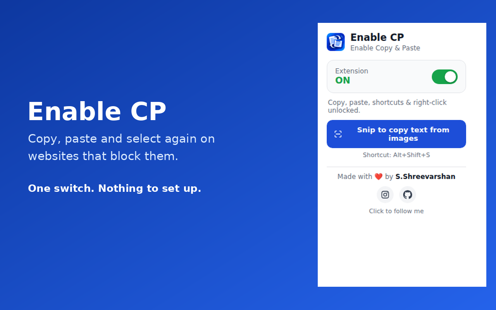
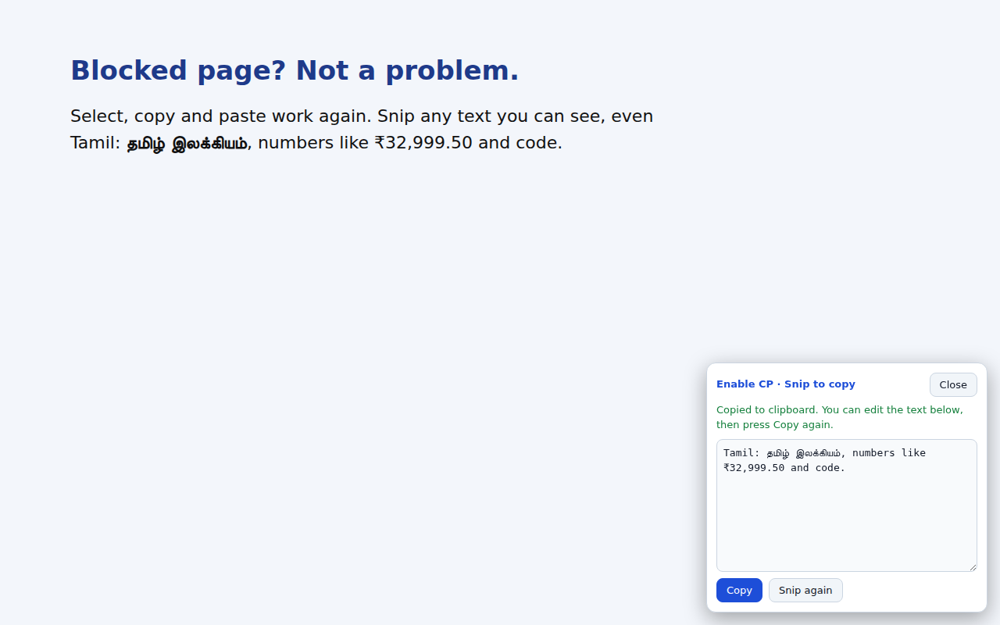

  

<h1 align="center">Enable CP</h1>

  <b>Copy, paste and select text again on websites that block it. Snip text out of pictures in English and Tamil.</b>

  
  
  
  
  

  

---

## Why Enable CP?

Some websites and online code editors stop you from selecting text, using the right-click menu, copying (Ctrl+C) or pasting (Ctrl+V). Enable CP switches those things back on, and adds a screen **Snip** tool that reads text from anything you can see.

| Problem | What Enable CP does |
|---|---|
| Text cannot be selected | Turns text selection back on, and scrolls while you drag to select long text |
| Ctrl+C / Ctrl+V / right-click blocked | Copy and paste work again, even in online code editors, and paste at the cursor |
| Text is inside a picture, video or canvas | **Snip to copy** reads it for you (English and Tamil, detected automatically) |
| You do not trust extensions with your data | Everything runs on your computer. **No data is collected and no internet is needed** |

## Features

- **Unlocks selection, right-click, copy, cut and paste** on blocked sites
- **Works in code editors** (CodeMirror, Monaco, Ace) and keeps your cursor position
- **Copies between websites and other apps** through the normal system clipboard
- **Snip to copy** (press **Alt+Shift+S**): drag a box over anything
  - *Real page text* (Tamil, emoji, code with indentation, tables, text in iframes) is copied **exactly**
  - *Pictures, canvas and video* are read with built-in OCR, **English and Tamil together**
- **Auto-scroll while selecting** near the edge of the page or of a scrolling panel
- **One ON/OFF switch** with a toolbar badge
- **Private by design**: no tracking, no analytics, no network requests

  

## Install

Works on **Windows, macOS and Linux** in Chrome and other Chromium browsers (Edge, Brave, Opera, Vivaldi).

1. Open the **Releases** page of this repository (right side of this page) and download **Enable-CP-v2.zip**, then unzip it.
   *(Or click **Code > Download ZIP** on this page and unzip it.)*
2. Open `chrome://extensions` (in Edge: `edge://extensions`) and turn on **Developer mode**.
3. Click **Load unpacked** and choose the unzipped folder, the one that contains `manifest.json`.
4. Pin the extension from the puzzle-piece icon, then reload the websites you already had open.

There is nothing else to download or set up. The text-reading files are already included.

> Using more than one Chrome profile or account? Each profile has its own extensions, so repeat the steps in every profile.

## How to use

- **Copy and paste:** check that the badge says **ON**, then use **Ctrl+C** and **Ctrl+V** as usual.
- **Snip to copy:** press **Alt+Shift+S** (or the Snip button in the popup) and drag a box. A panel shows the text and copies it. Edit it if you like, then press **Copy** again.
- **Switch it off** from the popup whenever you want a site to behave normally.

## Good to know

- OCR is not perfect. Check symbols such as `0`/`O` and `1`/`l`, and some Tamil letters such as கி and தி. Real page text is always exact.
- Printed text works best. Handwriting, strongly tilted photos and very tiny text work badly. Emoji inside pictures cannot be read.
- Snip does not work on `chrome://` pages or in the Chrome Web Store.
- Firefox and Safari are not supported yet.
- A website can change at any time, so a future update may be needed.

## Privacy

Enable CP collects **nothing**. Text you copy, paste or snip never leaves your device, and screenshots used by Snip are processed in memory and never uploaded. Read the full [Privacy Policy](PRIVACY.md).

## Use responsibly

Use this extension only where it is allowed, and follow your school's and website's rules.

## Built with

JavaScript, HTML, CSS and JSON on Chrome Extension **Manifest V3**. Text recognition uses [Tesseract.js](https://github.com/naptha/tesseract.js) 5.1.1 (Apache-2.0) with the English and Tamil models, running in an offscreen document. See [THIRD_PARTY_NOTICES.md](THIRD_PARTY_NOTICES.md).

## Author

Made with ❤️ by **S.Shreevarshan**
[Instagram](https://www.instagram.com/__shreevarshan__s) · [GitHub](https://github.com/Shreevarshan-1231)

## License

[MIT](LICENSE) © S.Shreevarshan
